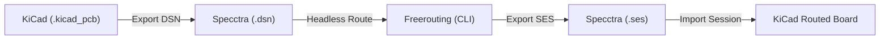

# Freerouting Autorouter Reference

*Java-based geometric autorouter for printed circuit boards.*

---

## 1. Overview & KiCad Integration Workflow

Freerouting computes multi-layer trace routes based on board outlines, keepouts, net classes, and design rules imported from KiCad:



---

## 2. Headless CLI Execution & Flags

Freerouting can run entirely headless inside build scripts or CI pipelines:

```bash
java -jar freerouting.jar \
  -de hardware/board.dsn \
  -do hardware/board.ses \
  --gui.enabled=false \
  --router.max_passes=200 \
  --router.job_timeout="00:15:00" \
  -mt 4
```

### Verified CLI Flags
| Flag / Option | Argument | Description |
| :--- | :--- | :--- |
| `-de` | `<file.dsn>[+<rules>]` | Design entry file. Specifies input Specctra `.dsn` netlist. |
| `-do` | `<file.ses>` | Design output file. Saves completed route session into `.ses`. |
| `--gui.enabled=false` | Boolean | Disables GUI window for headless automated batch routing. |
| `--router.max_passes` | Integer (e.g. `200`) | Maximum optimization and routing passes before stopping. |
| `--router.job_timeout`| String (`"HH:MM:SS"`)| Strict wall-clock timeout limit for routing job. |
| `-mt` / `--router.autorouter.max_threads` | Integer | Number of concurrent CPU threads for routing engine. |
| `-inc` | `<class1,class2>` | Net classes to ignore during autorouting (e.g. `-inc GND,VCC`). |
| `-l` | `<en,de,fr>` | Locale / language selection. |

---

## 3. Step-by-Step KiCad Import/Export Recipe

1. **Export DSN from KiCad**:
   - In KiCad PCB Editor: `File -> Export -> Specctra DSN...` -> Save as `hardware/board.dsn`.
   - *Ensure all critical components, connectors, mounting holes, and pre-routed power/RF traces are locked (`L` key) so Freerouting does not move or rip them up.*
2. **Execute Headless Route**:
   ```bash
   java -jar freerouting.jar -de hardware/board.dsn -do hardware/board.ses --gui.enabled=false --router.max_passes=150
   ```
3. **Import SES into KiCad**:
   - In KiCad PCB Editor: `File -> Import -> Specctra Session...` -> Select `hardware/board.ses`.
   - The newly generated tracks and vias are loaded onto the board.
4. **Post-Routing Cleanup**:
   - Run Zone Refill (`B` key) to regenerate ground planes.
   - Run Design Rules Check (`kicad-cli pcb drc`) to verify all clearances, annular rings, and unrouted net counts.
